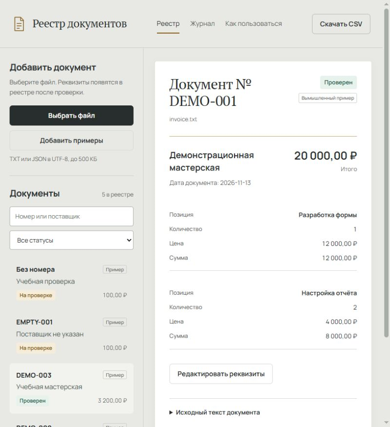

# Реестр документов

Локальный реестр для счетов и чеков в TXT и JSON. Приложение извлекает реквизиты и позиции, сверяет суммы и отмечает документы, которые требуют ручной проверки. Исправления попадают в реестр, исходный текст сохраняется для сверки.

## Запуск

1. Установите [Node.js 22 или новее](https://nodejs.org/), если его ещё нет.
2. Скачайте репозиторий через **Code → Download ZIP** и распакуйте архив в отдельную папку.
3. Откройте `start.bat`. Приложение откроется в браузере на **http://127.0.0.1:4193**.

Окно запуска оставьте открытым. Для остановки нажмите `Ctrl+C`. Установка npm-пакетов, аккаунты и ключи не нужны. Из терминала можно запустить `node server.js` или `npm start`.

## Попробовать за минуту

1. Нажмите **«Проверить учебный счёт»**. Реестр обработает [тот же TXT](examples/demo-invoice.txt), который можно скачать рядом с кнопкой и выбрать вручную.
2. Откройте исходный текст счёта **DEMO-104**. В файле указан итог 4 700 ₽, хотя две позиции стоят 4 800 ₽. Реестр показывает оба числа и отмечает документ как «На проверке».
3. Нажмите **«Исправить реквизиты»**, введите `4800` в поле итоговой суммы и сохраните. Статус сменится на «Проверен». Нажмите **«Выгрузить реестр в CSV»**, чтобы увидеть исправленный итог в таблице. В исходнике по-прежнему будет 4 700 ₽.

Повторная загрузка того же файла откроет сохранённый документ. Для собственных файлов можно взять за основу [TXT](examples/invoice.txt) или [JSON](examples/receipt.json).

## Что автоматизировано

- Извлечение поставщика, номера, даты, суммы и позиций.
- Проверка обязательных полей, действительной даты, положительных сумм и совпадения итога с суммой позиций.
- Пропуск одинакового содержимого; другой файл с таким же поставщиком и номером отправляется на проверку.
- Ручное исправление реквизитов и позиций с повторной проверкой.
- Сохранение исходного текста, статусов и последних 1000 операций, экспорт CSV в UTF-8.

## Ограничения и данные

Поддерживаются **TXT и JSON в UTF-8 до 500 000 байт**, не более 200 позиций. Все суммы — в рублях. Позиции необязательны: без них проверяются только реквизиты и итог. PDF, фотографии, OCR, налоги, скидки и произвольная вёрстка не поддерживаются. Проверка по правилам не подтверждает подлинность документа.

Реквизиты, оригиналы и журнал находятся в `data/register.json`. Папка создаётся при первом запуске и исключена из Git. Для резервной копии остановите приложение и скопируйте `data`. Приложение предназначено для одного человека и одного запущенного процесса; интернет для работы не требуется. Оно слушает только адрес этого компьютера.

Если порт занят, в PowerShell выполните `$env:PORT=4293`, затем `node server.js` и откройте `http://127.0.0.1:4293`. При ошибке чтения хранилища приложение остановится и не заменит его пустым.

## Как устроено

**JavaScript / Node.js**: `server.js` обслуживает страницу и HTTP API; `engine.js` извлекает реквизиты, проверяет данные и записывает JSON через временный файл с последующим переименованием. **HTML и CSS**: интерфейс работает без сборки; `public/app.js` связывает загрузку, просмотр, исправление и журнал.

Встроенных модулей достаточно для этой задачи: проект можно изучить и запустить без установки зависимостей. SHA-256 используется для сравнения содержимого файлов. При выгрузке CSV значения с признаками формул экранируются.

Шрифты Manrope и [PT Serif Regular](https://github.com/google/fonts/tree/main/ofl/ptserif) включены локально по SIL Open Font License; лицензии находятся в `public/fonts/OFL.txt` и `public/fonts/PTSerif-OFL.txt`. Заголовки используют PT Serif. Принцип одновременного просмотра реестра и документа выбран по референсу [Invoice Maker Dashboard](https://www.pinterest.com/pin/1090715603519092066/), плотность списка и поиск — по [21st.dev](https://21st.dev/community/components?q=data%20table). Чужие изображения и код компонентов не включены.

Подготовка приватного репозитория описана в [GITHUB.md](GITHUB.md). Ничего не загружается автоматически при запуске приложения.
